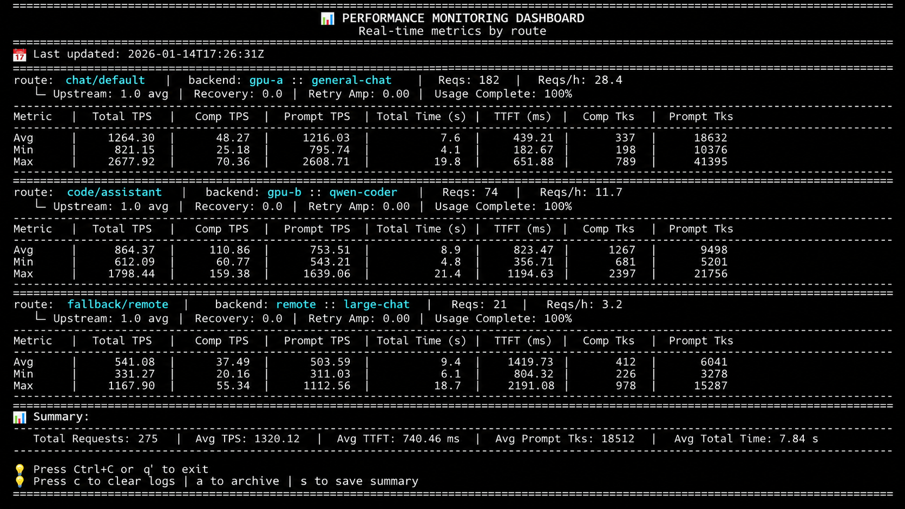
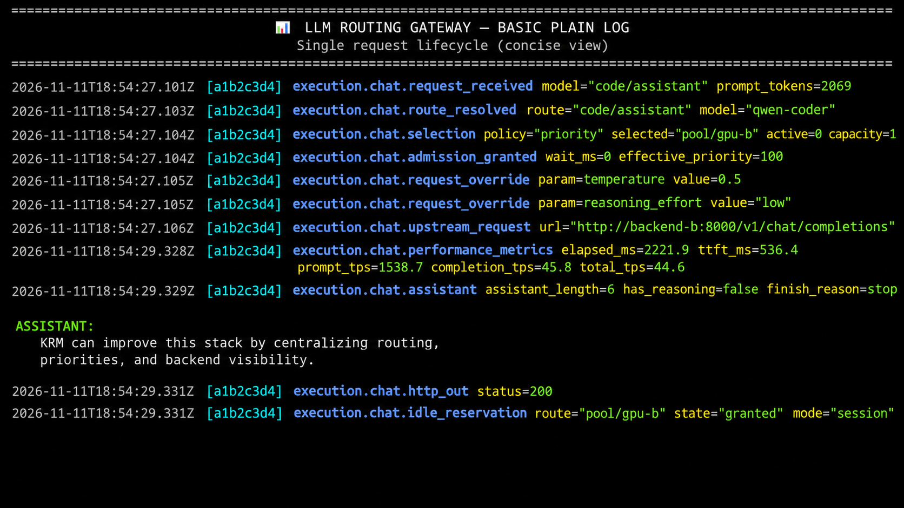

<p align="center">
  
</p>

<p align="center">
  <strong><em>Keep your LLM rolling.</em></strong><br>
  Intelligent routing for local, remote, and hybrid LLM infrastructure.
</p>

<p align="center">
  <a href="https://www.gnu.org/licenses/agpl-3.0"></a>
  
</p>

# KeepRoLLMing — Intelligent Routing for LLM Infrastructure

KeepRoLLMing (KRM) is an open-source, OpenAI-compatible inference gateway for
smart routing, load balancing, observability, and resilient access to local
and remote LLM backends.

**One endpoint for your clients. Multiple backends behind it.** Keep stable
client-facing routes while changing backend topology, routing policies, and
workload priorities in YAML—without reconfiguring every application.

Inspired by the role Nginx plays in web infrastructure, KRM brings intelligent
routing, workload-aware balancing, and observability to LLM inference.

```text
      LibreChat      Coding agents      API clients
            \             |             /
             v            v            v
           +-----------------------------+
           |        KeepRoLLMing         |
           | Routing + load balancing    |
           | Admission + cache affinity  |
           | Observability               |
           +-----------------------------+
                  /       |       \
                 v        v        v
            Local GPU A  GPU B   Remote API
             llama.cpp   vLLM   OpenAI-compatible
```

KRM is a gateway, not an inference server: it coordinates requests across
the model servers you already run.

> **Alpha software.** Configuration and extension APIs may evolve before 1.0.
> Requests and responses can be logged locally. Review `observability` settings
> before using sensitive traffic or exposing the service to untrusted networks.

## Running LLMs? Let your agent evaluate KRM.

**Already running LLMs? Ask your coding agent whether KRM could improve your infrastructure.**
Copy this prompt into Codex, Claude Code, Qwen Code, or your preferred agent:

```text
Review https://github.com/danielebruneo/KeepRoLLMing
and evaluate whether it could improve my existing LLM inference infrastructure.

Focus on routing, load balancing, concurrency, cache affinity,
observability, integration complexity, and operational overhead.

Compare KRM with what I already have. Identify concrete benefits,
limitations, and risks. Distinguish published features from unreleased work.

Tell me if KRM is worth testing—and why. If my stack doesn't need it, say so.
Do not install or modify anything without my approval.
```

## Why put KRM in front of your backends?

A generic reverse proxy can forward traffic. LLM workloads also have long
generations, expensive prefills, conversation locality, and competing service
priorities. KRM makes these request-level policies explicit across local GPUs,
remote APIs, or a hybrid deployment, independently of your agent framework.

### Routing, balancing, and workload scheduling

Give each workload a stable route over a pool of backends. Prioritize
interactive coding over background bots, favor preferred workers, or spread
requests across less busy servers. Capacity-aware queues help different
workloads share infrastructure without interrupting active generations.

Change backend preferences and inference settings centrally while clients
continue using the same endpoint and route names.

### Cache-conscious sessions and predictive promotion

Keep conversations on warm backends instead of rebuilding long prompts on a
different worker at every turn. Session affinity and reservations help preserve
continuity for interactive agents, while shared workers can serve multiple
workloads together.

When a better worker becomes available, KRM can weigh the cost of rebuilding
context against the expected benefit over upcoming turns. Observed performance
and workload estimates inform whether to keep the session in place or promote
it at the next request.

### Observability for routing and operations

Understand where requests go, why they wait, and how your backends perform.

- **Performance monitoring:** compare throughput, response latency, time to
  first token, and request activity across routes and backends.
- **Readable logs:** follow a request from routing through completion, including
  queue waits, priorities, backend promotions and upstream errors.
- **Operational APIs:** inspect running and waiting requests, backend capacity,
  recent errors and usage, or connect that information to your own dashboards.

**Performance dashboard:** compare route activity, throughput and latency
across multiple backends.



**BASIC PLAIN logging:** follow a request through color-coded operational events.



<sub>Illustrative mockups with synthetic data, not benchmarks; output details may differ.</sub>

Keep operational views on trusted networks. See the
[HTTP API reference](docs/API_REFERENCE.md) for access controls and endpoint details.

### Resilience and access policies

Keep serving through backend failures with fallback routes and circuit
breakers. Share infrastructure securely: let trusted LAN clients connect
without keys while requiring credentials for selected public routes.

See the [routing guide](docs/ROUTING_AND_CONCURRENCY.md) for policies and tuning,
and [Upgrading](docs/UPGRADING.md) and the [changelog](CHANGELOG.md) for release changes.

## Quick start

Requires Python 3.11 or newer.

```bash
git clone https://github.com/danielebruneo/KeepRoLLMing.git
cd KeepRoLLMing
bash scripts/setup.sh
bash scripts/start-with-fake.sh
```

In another terminal, while the fake server is running:

```bash
curl -s http://127.0.0.1:8000/v1/chat/completions \
  -H 'content-type: application/json' \
  -d '{"model":"internal/fake","messages":[{"role":"user","content":"Hello"}],"stream":false}'
```

The fake backend is a deterministic smoke test. Stop it with `Ctrl-C` in the
terminal that runs `start-with-fake.sh`.

## Connect an LLM backend

```bash
cp config.example.yaml config.yaml
# Edit config.yaml: set base/local.model and base/local.upstream_url.
./krm serve --port 8000 --config config.yaml
```

Send requests using the configured route name, for example `chat/local` or
`code/assistant`. Routes can point to llama.cpp, vLLM, LM Studio, or another
OpenAI-compatible API. See [Configuration](docs/CONFIGURATION.md).

For a local background process with logs in a writable project directory:

```bash
./krm start --port 8000 --config config.yaml
./krm status --port 8000
```

To connect an application, use KRM's OpenAI-compatible base URL and the
client-facing route name as its model. See the copy-paste examples for the
[OpenAI Python SDK and LibreChat](docs/CLIENT_INTEGRATION.md), and the complete
[HTTP API reference](docs/API_REFERENCE.md).

## Routes in practice

Routes are a small configuration layer between clients and backends. A private
base route holds shared connection settings; public routes inherit it and give
clients meaningful, stable model names.

Here `is_private: true` marks an inheritance-only template; it is not a network
access restriction. Use `client_access` and `api_keys` to protect serving routes.

```yaml
routes:
  base/local:
    is_private: true
    model: "qwen-local"
    upstream_url: "http://127.0.0.1:8080"

  chat/default:
    extends: base/local
    pattern: "chat/default"

  chat/creative:
    extends: base/local
    pattern: "chat/creative"
    overrides:
      temperature: 0.8
      top_p: 0.95
      max_tokens: 2048
      reasoning_effort: high
```

Clients use `chat/default` or `chat/creative`; the configured `overrides` are
applied to the request sent upstream. You can move either route to another
backend later without changing client configuration.

`reasoning_effort` is forwarded as the OpenAI-compatible top-level request
field used by LibreChat's reasoning control. Its supported values are defined
by the selected upstream model/runtime; for example, a Qwen-compatible backend
may accept `low`, `medium`, or `high`.

Routes can also fail over to another route after an upstream failure:

```yaml
routes:
  base/remote:
    is_private: true
    model: "remote-chat-model"
    upstream_url: "https://api.example.com"
    api_key: "replace-me"

  chat/remote:
    extends: base/remote
    pattern: "chat/remote"

  chat/resilient:
    extends: base/local
    pattern: "chat/resilient"
    fallback_chain: ["chat/remote"]
```

Here a request to `chat/resilient` uses the local backend first, then tries
`chat/remote` only if the upstream attempt fails. Inheritance also composes
filter settings, so route-specific behaviour remains explicit rather than
being embedded in each client. See the complete, validated
[`config.example.full.yaml`](config.example.full.yaml) for all route fields and
built-in filters.

For multiple local workers, a route can select from concrete backend routes
without exposing that topology to clients:

```yaml
routes:
  code/runner-a:
    extends: base/local
    upstream_url: "http://gpu-a.example:8000"
    max_concurrent: 1

  code/runner-b:
    extends: base/local
    upstream_url: "http://gpu-b.example:8000"
    max_concurrent: 1

  public/code:
    extends: base/local
    balance:
      targets:
        - {route: code/runner-a, priority: 100}
        - {route: code/runner-b, priority: 80}
```

KRM uses bounded session affinity to prefer an eligible backend already warm
for a conversation, while respecting each target route's capacity. See
[Configuration](docs/CONFIGURATION.md#smart-routing-with-balance) for the
configuration contract and [Routing, Balancing & Concurrency](docs/ROUTING_AND_CONCURRENCY.md)
for the selection, reservation, queueing, and fallback rules.

## Optional request and response modules

```text
OpenAI client → route resolution + access checks → selection + admission
              → request filters → upstream backend
              ← canonical streaming pipeline ← stream finalizers
```

Routes are declared in `config.yaml`. Each route may inherit settings from a
base route and enables filter modules under a direct `filters:` mapping. YAML
mapping order is not significant: each module declares its own priority, which
can be explicitly overridden per route when required.

These optional modules complement the gateway. Enable the behaviors each route needs:

- `system_prompt` — inject or replace a system prompt.
- `summarization` — repack a conversation when context pressure requires it.
- `multimodal_validator` — repair image marker/payload mismatches.
- `tool_rewrite` — convert supported XML pseudo-tool calls to OpenAI calls.
- `model_nudge` — continue a response that ends in a configured lazy pattern.
- `model_tool_loop_stopper` and `reasoning_loop_stopper` — interrupt repeated behaviour.
- `timestamp` — inject request time and append a response timestamp.

The canonical streaming pipeline handles reasoning, tool calls, terminal
`finish_reason` and `[DONE]`; eligible structured tool calls stream as they
arrive without bypassing loop-safety controls. See the
[filter pipeline](docs/FILTER_PIPELINE.md) for module and streaming contracts.

## Configuration examples

- [`config.example.yaml`](config.example.yaml): minimal configuration to copy
  and edit.
- [`config.example.full.yaml`](config.example.full.yaml): validated reference
  for all public settings and built-in filter options.

Do not copy placeholder API keys or URLs from the full example.

### Route access and status

Keep personal routes LAN-only without reconfiguring your existing clients,
while exposing selected routes with API keys:

```yaml
client_access:
  default: lan
  lan_networks: ["127.0.0.0/8", "::1/128", "192.168.1.0/24"]  # Use your actual LAN.
  trusted_proxies: []  # Add only the exact addresses of reverse proxies you control.

routes:
  chat/personal:
    model: "local-model"
    upstream_url: "http://127.0.0.1:8080"

  public/chat:
    extends: chat/personal
    client_access: public
    api_keys: ["replace-with-a-client-key"]
```

`chat/personal` accepts LAN callers without a key; `public/chat` accepts callers
from any network only with an accepted key. This is an explicit configuration,
not the default network policy. Route names such as `public/` are labels, not
security rules. Behind a reverse proxy, configure its trusted address so KRM
can evaluate the original client IP safely.

Routes can be protected with one or more client API keys declared in YAML. Keys
are inherited through route composition, so a private base route can secure a
family of public-facing models while selected routes can opt out explicitly.
KRM accepts the standard `Authorization: Bearer <key>` header and never forwards
that client credential to an upstream backend.

For trusted operational networks, `GET /routes` exposes a read-only status
snapshot of public routes: resolved backend details, declared capabilities,
rolling activity/errors/performance, and requests currently in flight. See
[Configuration](docs/CONFIGURATION.md#client-api-keys) for API-key setup,
[client network policies](docs/CONFIGURATION.md#client-network-access-policies), and
[the route-status endpoint](docs/CONFIGURATION.md#private-route-status-endpoint)
for its security boundary and response contract.

`/routes` and `/metrics` enforce the global `client_access` network policy,
whose default is `any`; inference-route API keys do not protect them. Restrict
operational access explicitly.

## Documentation

| Guide | Purpose |
|---|---|
| [Getting started](docs/GETTING_STARTED.md) | Install, run the fake backend, connect an upstream |
| [Client integration](docs/CLIENT_INTEGRATION.md) | Connect the OpenAI Python SDK or LibreChat |
| [HTTP API reference](docs/API_REFERENCE.md) | Endpoints, authentication, responses, and streaming |
| [Configuration](docs/CONFIGURATION.md) | Root settings, routes, inheritance, observability |
| [Upgrading](docs/UPGRADING.md) | 0.9.6 behavior changes, defaults, and deployment checks |
| [Routing, balancing & concurrency](docs/ROUTING_AND_CONCURRENCY.md) | Target selection, affinity, reservations, and admission |
| [Concepts](docs/CONCEPTS.md) | Short glossary of routes, filters, and runtime controls |
| [Filter pipeline](docs/FILTER_PIPELINE.md) | Module lifecycle and streaming behaviour |
| [Deployment](docs/DEPLOYMENT.md) | Launcher, graceful shutdown, reverse proxy |
| [Troubleshooting](docs/TROUBLESHOOTING.md) | Startup, routing, logging, streaming diagnosis |
| [Contributing](CONTRIBUTING.md) | Development setup and verification loop |

## Contributing

```bash
bash scripts/setup.sh --dev
bash scripts/run-single-test.sh tests/filters/test_registry.py
bash scripts/run-parallel-tests.sh
.venv/bin/ruff check keeprollming tests
.venv/bin/ruff format --check keeprollming tests
```

See [CONTRIBUTING.md](CONTRIBUTING.md) for the public contribution workflow.

## License

AGPL-3.0-only. See [LICENSE](LICENSE).
